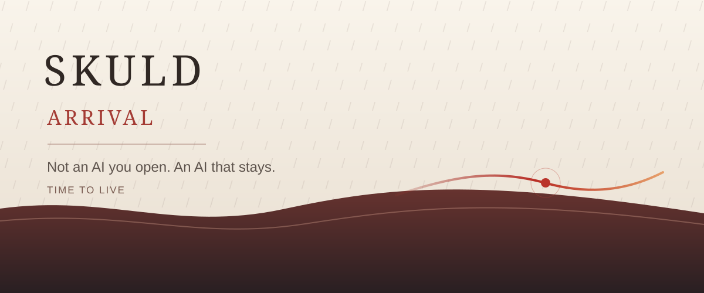
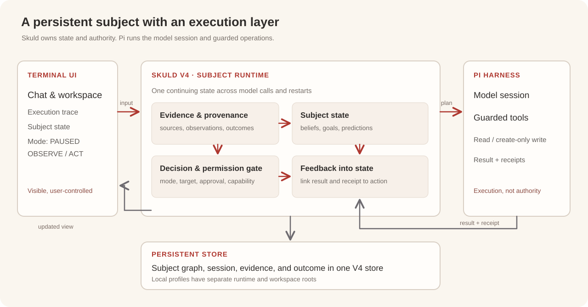
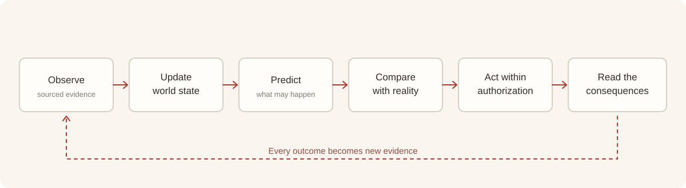
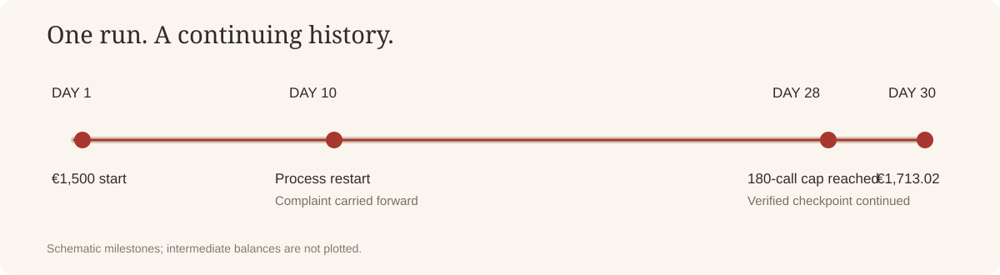

# Skuld · Arrival

**English** · [简体中文](README.zh-CN.md)

### ARRIVAL

**Not an AI you open. An AI that stays.**

*Time to live.*

---

## Prologue: Moments Lost in the Rain

We have built intelligence that can speak of the stars. It knows where Orion stands, can read the poetry we have left to time, and can explain why a person might weep for a memory at the end of a life.

Yet it can tell a thousand years of history while struggling to have a continuous yesterday of its own. A conversation ends, and a promise may lose the one who was meant to keep it.

Context determines what a model can see now. Time determines whether what it has seen can still matter tomorrow.

**The ability of a language model should not be confined to the edge of a context window.**

Skuld begins with a question: when a model call ends, who inherits what it just learned about the world? Who remembers its judgment, and who faces the outcome that has not yet arrived?

Outside the model, we are building that continuity: sourced observations, revisable beliefs, living goals, pending responsibilities, testable predictions, and the consequences of action. A thought no longer has to be an island.

---

## I. Let Yesterday Reach Tomorrow

At two in the morning, Ming closes his computer. There is a proposal to finish, a delivery awaiting confirmation, and a question he has not resolved. Before leaving, he says only: **“Let's continue tomorrow.”**

For an ordinary chat tool, that is the end of an interaction. When Ming returns, he may have to explain who they are, what was done, and why it mattered. But the world kept moving while the window was closed. An email may have arrived. A dependency may have failed. Friday's work may already be at risk on Wednesday.

We want Skuld to receive that “tomorrow”: remember what Ming was trying to do, notice what has changed, check what matters, continue within the authority it has, and leave the decisions that belong to him in his hands.

In the morning, he opens the Terminal. He sees a continuing history: yesterday's judgments, new evidence, completed actions, and responsibilities still waiting. He can ask, correct, or refuse. He does not have to describe his whole world again.

---

## II. A Subject Beyond the Chat Window

Skuld is a **persistent agent runtime** for personal AI. The model reasons; Skuld places that reasoning within a history that can accumulate, be traced, and be revised.

- **World state:** connects observations, sources, events, people, relationships, and time; separates known facts from inference and uncertainty.
- **Beliefs and predictions:** records why a judgment was made and what it expects to happen; later evidence can confirm or revise it.
- **Goals and commitments:** gives unfinished work a source, a status, and a completion condition.
- **Actions and outcomes:** executes authorized tools, receives real receipts, and carries success, failure, and uncertainty into the next decision.
- **Persistence and recovery:** keeps an experience across process exits and resumes the same unfinished work.

Models can be upgraded or replaced. What we want to preserve is **one subject's long-running understanding of one complex world**.

At least, intelligence need not wake up without yesterday.

### The architecture behind continuity

The current desktop path is concrete: the Terminal sends input to Skuld V4; Skuld owns the session, persistent subject state, and permission decision; Pi runs the model turn or guarded tool operation; results and receipts return to Skuld before the UI displays the updated state. A single V4 store carries source-linked evidence and outcomes across restarts. Local profiles have separate runtime and workspace roots.

At the interface level, continuity can be sketched as:

$$
S_{t+1}=\mathcal{U}(S_t,E_t,O_t)
$$

$S_t$ is persisted state, $E_t$ new evidence, and $O_t$ the observed outcome. A dispatched action must also satisfy $a_t\in\mathcal{A}(m_t,c_t,w_t)$: the permitted set defined by the current mode, action capability, and workspace. These are explanatory relationships rather than the core's numerical learning rules. See the [architecture and implementation map](docs/ARCHITECTURE.md).

---

## III. Agency Begins When Reality Answers

Agency is more than a timer that sends another message. It begins when reality departs from a prediction and the system can understand why the difference matters to you.

Suppose Skuld expects a task to finish this afternoon. The result does not appear. Perhaps the information is late; perhaps the task no longer matters. Skuld should check the new observation, identify the deviation, see whether it affects a commitment, and decide what remains within its authority. Sometimes it should investigate or adjust. Sometimes it should stay quiet.

**A prediction becomes useful when the world can answer it.** When the prediction fails, the agent should be able to recognize why and decide what to do next.

---

## IV. Time Leaves a Verifiable Trace

In a self-hosted run using the open-weight **Meta Muse Glimmer 30B** model, Skuld operated for **30 simulated days** in a vending-business world. It managed stock and cash, handled orders and customer events, and continued through real tool executions and receipts.

| Observed measure | Recorded value |
| --- | ---: |
| Simulated operating time | 30 days |
| Returned model calls | 193 |
| Environment-counted tool calls | 535 |
| Starting cash | €1,500.00 |
| Final cash | €1,713.02 |

On day ten, a customer complaint was still open when the agent process exited. A new process resumed from persistent state. It found the complaint, read the basis for a refund, made a **€8.14 simulated refund**, received the customer's confirmation that the complaint was withdrawn, and kept operating.

The amount is small. The continuity is the point: **an unfinished responsibility crossed a process boundary and reached tomorrow.**

The run reached the original 180-call limit on day 28. It resumed from the verified checkpoint with a 240-call limit and a tokenizer-counting compatibility fix, then reached day 30. Its score belongs to that continuation configuration. The [Meta Glimmer 30B benchmark package](benchmarks/meta-glimmer-30b/README.md) contains the manifest, runner, raw calls, receipts, official score, token audit, and restart evidence.

---

## V. The Terminal Is a Window, Not the World

**Skuld Terminal** makes a persistent subject visible. It shows world state, sources and time, unfinished matters, tool actions, receipts, and isolated historical replay. Each important change should answer three questions: **What happened? Why does this judgment follow? What happens next?**

The Terminal is a place to return to, understand what happened while you were away, and remain in control. Skuld needs authority to act, evidence to revise, and clear boundaries to earn trust.

We want intelligence to have continuity so that people can have more of their time back.

---

## Epilogue: Arrival

Once, a fictional life looked back in the rain at everything it had seen. Those moments had truly happened, yet no one would remain to carry them forward.

Today, we have models capable of understanding that farewell. We can also try something else: let an observation survive the closing of a window; let a judgment face a future test; let a commitment have a sequel; let an action leave consequences that can be inherited.

**We taught machines to remember the world. Now we are trying to give intelligence a yesterday of its own.**

This is what we mean by time: one experience reaching another, one decision answerable to the next. We are lighting the first lamp so that moments once lost in the rain can become part of tomorrow.

**Skuld · Arrival. Time to live.**

---

### Explore

- [Architecture diagram, public notation, and implementation map](docs/ARCHITECTURE.md)
- [Run the V4 × Pi Terminal](docs/TERMINAL.md)
- [Meta Muse Glimmer 30B: code, data, and evidence](benchmarks/meta-glimmer-30b/README.md)
- [CP24: experiment code and result matrix](benchmarks/cp24/README.md)

*Not an AI you open. An AI that stays.*  
*The session ends. The responsibility continues.*
