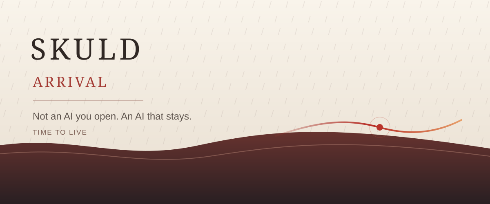
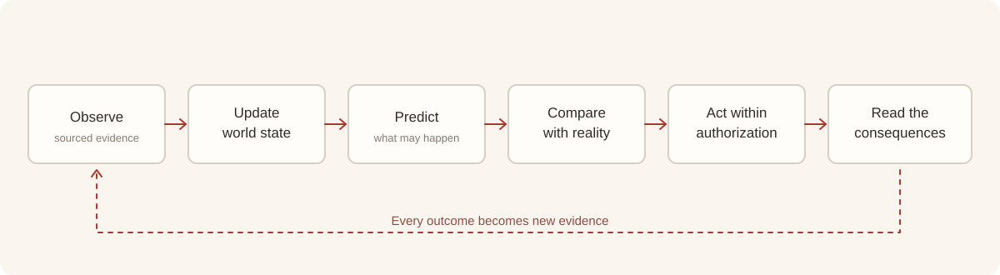
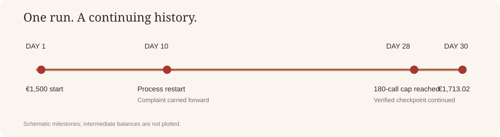

# Skuld · 降临

[English](README.md) · **简体中文**



### ARRIVAL

**Not an AI you open. An AI that stays.**

*Time to live.*

---

## 序：那些消失在雨中的瞬间

我们已经创造出能够谈论群星的智能。

它知道猎户座的坐标，知道遥远的战舰与传说中的星门；它读过人类留给时间的诗，也能够解释，一个人为何会在生命的尽头为自己的记忆落泪。

但它也有一个近乎荒诞的局限：

它能讲述千年的历史，却很难拥有连续的昨天。它能推演无数个明天，却未必需要在明天面对自己今天的判断。它可以理解承诺的含义，而一次对话结束，承诺就可能失去继续履行的主体。

我们给了模型理解世界的语言，却还没有充分给它**在世界中延续一段经历的时间**。

上下文决定它此刻能看见什么。

时间决定它曾经看见的东西，能不能在未来继续产生后果。

**大语言模型的能力，从来不应该被桎梏在上下文窗口的边界里。**

Skuld 由此诞生。

我们不再只问：模型在这一次调用中能回答什么？

我们开始问：**当调用结束，谁来继承它刚刚理解的世界？谁来记得它所作的判断？谁来面对那些尚未抵达的结果？**

在模型之外，我们尝试建立这样的连续性。

不是给模型加上一段越来越长的聊天记录，而是给智能一条能够穿越会话、进程与时间的经历：有来源的观察、可以修订的信念、仍然有效的目标、尚未履行的责任、等待检验的预测，以及行动留给现实的后果。

从此，一次思考不必是孤岛。

---

## 第一章：让昨天抵达明天

一个叫小明的人，在凌晨两点关掉电脑。

他还有一份没有写完的方案，一项等待对方确认的交付，以及一个反复思考却尚未解决的问题。离开前，他只说了一句：

**“明天继续。”**

对于传统的对话工具，这是一段交互的终点。等他再回来，往往又要从头解释：我们是谁、做到了哪一步、为什么这件事重要。

但世界不会随着窗口关闭而暂停。

一封邮件可能抵达；一项依赖可能失效；原定周五完成的工作，可能在周三就出现风险。现实持续变化，而一个人的注意力无法始终值守。

我们希望 Skuld 能够接住那个“明天”：

记得小明真正想完成的事，辨认哪些条件已经改变，判断是否值得进一步查证，在已有授权内继续推进，并把无法替他决定的事情留给他自己。

清晨，他打开 Terminal。

屏幕上不是又一场从零开始的问答，而是一段已经继续向前的经历：昨天有哪些判断，夜里出现了什么新证据，哪些事已经处理，哪些责任还在等待。

他可以追问，可以纠正，可以拒绝。

但他不必再次把自己的整个世界从头讲一遍。

**我们看见小明，是因为我们需要一个普通人的夜晚，来说明一种此前不存在的智能，怎样第一次开始拥有自己的明天。**

---

## 第二章：一个不以对话为边界的主体

Skuld 不是另一个基础模型，也不是贴在聊天界面上的一层记忆插件。

它是面向个人 AI 的**持续主体运行时（Persistent Agent Runtime）**。模型负责推理；Skuld 负责让推理发生在一段可以累积、可以追溯、可以修订的经历之中。

我们正在把主体的连续性从模型的上下文窗口中解耦出来。

- **世界模型（World State）**：把观察、来源、事件、人物、关系、时间与状态连接起来；区分已知事实、推断和未知，而不把旧消息直接当作今天的现实。
- **信念与预测（Beliefs & Predictions）**：记录一个判断为何成立，以及它期待现实如何发展；新的证据到来时，允许它被证实、修订或推翻。
- **目标与责任（Goals & Commitments）**：让“我会继续做”不只是一句话，而是一项有来路、有状态、也有结束条件的未完事项。
- **行动与后果（Actions & Outcomes）**：执行经过授权的工具行动，接收真实回执，把成功、失败和不确定性带回下一次决策。
- **持久性与恢复（Persistence & Recovery）**：让进程退出不自动清空历史；同一个主体在恢复后仍能认识已经发生的事，并继续处理未完事项。

模型可以升级、替换，甚至由不同架构的系统提供。我们希望保留下来的，是**同一个主体对同一个复杂世界的长期认识**。

Skuld 所建造的，是可实现、可检验、可由人掌握的时间连续性。

但至少，智能不必每次醒来都失去昨日。

---

## 第三章：主动性，来自现实对预测的回答

真正的主动性，不是让一个定时器不停发消息。

它始于一种更细腻的能力：**意识到现实与原先的预期发生了偏离，并且理解这种偏离为什么与你有关。**

假设 Skuld 预计某项工作会在下午完成。

下午到了，结果没有出现。

这本身还不是催促的理由。也许只是信息延迟，也许那件事已经不再重要。Skuld 需要先核对新的观察，理解偏差来自哪里，判断它是否影响正在履行的承诺，以及行动是否仍在授权范围内。

必要时，它可以继续查证、调整计划、准备替代方案；不必要时，它应该保持安静。

我们把这条研究与工程主线写成一个持续循环：

```text
Observe the world
       ↓
Update the world state
       ↓
Predict what may happen
       ↓
Compare prediction with reality
       ↓
Recognize what matters
       ↓
Act within authorization
       ↓
Read the consequences
       ↺
```

从观察到行动，从后果到修订。**预测的价值，不在于永远正确，而在于错误到来时，智能能够认出自己为什么错了，下一步又该如何做。**

这是 Skuld 希望抵达的主动性。



---

## 第四章：时间第一次留下了可核对的痕迹

理念要接受现实的检验。

在一项基于 **Meta Muse Glimmer 30B** 开放权重模型的自托管运行中，Skuld 进入了一个持续 **30 个模拟日**的经营世界。它需要管理库存与现金、处理订单、面对顾客事件，并通过真实的工具执行与回执继续决策。

这段运行记录包含：

| 观测项 | 实际记录 |
| --- | ---: |
| 模拟经营时间 | 30 天 |
| 获得返回的模型调用 | 193 次 |
| 环境计数的工具调用 | 535 次 |
| 起始现金 | €1,500.00 |
| 终局现金 | €1,713.02 |

其中有一个不宏大的瞬间。

模拟第十日，一项顾客投诉已经抵达，尚未处理。agent 进程退出，随后由一个新的进程恢复。它继承此前的事件与行动历史，找到未解决的投诉，读取退款依据，执行 **€8.14 的模拟退款**，获得顾客撤回投诉的工具回执，然后继续经营。

这笔钱微不足道。

但它提出了一个值得认真回答的问题：

**进程结束了，未完成的事情，是否也必须结束？**

在这条真实记录中，答案是否定的。

这次模拟经营运行在第 28 日触及原模型调用上限后，从检查点将上限提高至 240 次，并修复 token 计数兼容问题，最终抵达第 30 日。评分对应这条续跑轨迹。完整配置、调用、评分和恢复证据见 [Meta Glimmer 30B Benchmark](benchmarks/meta-glimmer-30b/README.md)。

**一项未完成的事确实跨过了进程的边界，进入了明天。**



---

## 第五章：Terminal 是窗口，不是世界

**Skuld Terminal** 让持续主体的运行过程变得可见。

这里可以看到世界状态、来源与时间、未完事项、工具行动、回执，以及历史运行的隔离回放。我们希望每一项重要变化都能回答三个问题：

**发生了什么？为什么这样判断？接下来准备做什么？**

Terminal 不是要把用户困在另一个必须时时盯着的控制台里。恰恰相反，它应当成为一个人偶尔打开时，就能理解此前发生的一切、并继续掌握决定权的地方。

Skuld 需要授权才能行动，需要证据才能修订，需要边界才能被信任。世界模型应当服务于人，而不是取代人决定什么值得生活。

我们希望智能拥有连续性，不是为了让人交出自己的时间。

**而是为了把时间还给人。**

---

## 终章：降临

曾经有一个虚构的硅基生命，在雨中回望自己见过的宇宙。

那些壮丽的瞬间真实地发生过，却要随着他的消逝永远失去一个能够记得它们的“我”。那段告别之所以令人动容，是因为它让人突然意识到：记忆的悲剧，并不总是遗忘了什么，而是**再也没有谁能把它带向明天**。

今天，我们创造了能理解那段告别的模型。

它们拥有惊人的语言、知识与推理天赋。

但我们终于可以尝试另一件事：

让一次观察不随窗口消失，让一个判断面对未来的检验，让一个承诺拥有后续，让一个行动在真实世界留下能够被继承的后果。

**过去，我们让机器记住整个世界。**

**现在，我们试着让智能拥有自己的昨天。**

这就是我们所说的时间。不是屏幕右上角持续跳动的数字，而是一段经历能够抵达另一段经历，一次决定能够为下一次决定负责。

天赋异禀的硅基造物，距离超越边疆也许还有很多未知的难题。但这一道边界，我们已经开始亲手触碰。

我们只是点亮第一盏灯，让那些本该消失在雨中的瞬间，有机会成为明天的一部分。

**Skuld · 降临。**

**Time to live.**

---

*Not an AI you open. An AI that stays.*  
*The session ends. The responsibility continues.*
