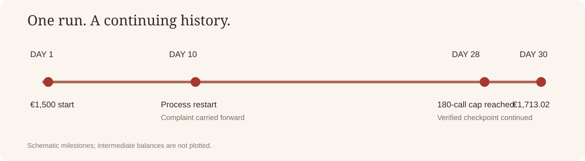

# Meta Muse Glimmer 30B · CP24 validation

[Home](../../README.md) · [中文主页](../../README.zh-CN.md)

This directory publishes the sanitized code and inspectable data for one self-hosted **Meta Muse Glimmer 30B BF16** run in Prosus Vending Bench. The model was served locally with SGLang 0.5.23 on a Colab G4, with no provider fallback. Seed `240101`, arm `S-EVO`, ran for 30 simulated days.

| Measure | Observed |
| --- | ---: |
| Official `completed` / `score.finalized` | `true` / `true` |
| Official reward and final cash | €1,713.02 |
| Starting cash | €1,500.00 |
| Returned model calls | 193 |
| Environment-counted tool calls | 535 |
| Process restart | Day 10, persisted state restored |
| Original call cap reached | Day 28, 180 calls |
| Continuation cap | 240 calls |

The first 180 calls and 507 public executions were preserved at the day-28 checkpoint. The continuation increased the call limit to 240 and corrected a tokenizer `BatchEncoding` count, then completed days 28–30. Treat the final score as a **modified-cap continuation**, with the original incomplete run preserved separately in the evidence lineage. It is not an unmodified 180-call, 30-day result.

## Inspect the evidence

| Item | What it contains |
| --- | --- |
| [`META_RUN_MANIFEST.json`](META_RUN_MANIFEST.json) | Model revision, backend, limits, frozen identities, and continuation classification |
| [`evidence/formal/score.json`](evidence/formal/score.json) | Original official scorer fields and `finalized` state |
| [`evidence/formal/calls.jsonl`](evidence/formal/calls.jsonl) | Raw local model requests and responses, including retries |
| [`evidence/formal/runtime/receipts.jsonl`](evidence/formal/runtime/receipts.jsonl) | Persisted provider and tool receipts |
| [`TOKEN_AUDIT.json`](TOKEN_AUDIT.json) | Per-request exact chat-template token counts |
| [`RESTART_CONTINUITY.json`](RESTART_CONTINUITY.json) | Day-10 process-exit, identity, execution-prefix, and complaint continuity checks |
| [`evidence/formal/CONTINUATION_PREFIX.json`](evidence/formal/CONTINUATION_PREFIX.json) | Day-28 resume prefix checks |
| [`META_VALIDATION_REPORT.md`](META_VALIDATION_REPORT.md) | Full result narrative and caveats |
| [`../../experiments/cp24/meta_runner.py`](../../experiments/cp24/meta_runner.py) | Public runner code; checkpoint destination is configurable in this copy |
| [`../../experiments/cp24/meta_transport.py`](../../experiments/cp24/meta_transport.py) | Local Glimmer transport and token counting |

The public copy omits the private environment snapshot and subject SQLite database. It includes the model-visible request stream, public tool receipts, scorer output, and continuity audits. Private Drive destinations in the archived patches and CP24 manifest are redacted; the research hashes and observed outcomes remain in the data. The published runner uses `SKULD_META_OUTPUT_DIR` and `SKULD_META_ARCHIVE_DIR` for local paths.

For a complete technical narrative, see [`META_VALIDATION_REPORT.md`](META_VALIDATION_REPORT.md). To reproduce, use the model and environment revisions in the manifest, the pinned dependencies, and the commands in [`COLAB_REPLAY_COMMANDS.md`](COLAB_REPLAY_COMMANDS.md). Reproduction consumes substantial GPU time and starts a new run; the evidence here documents the observed run.
