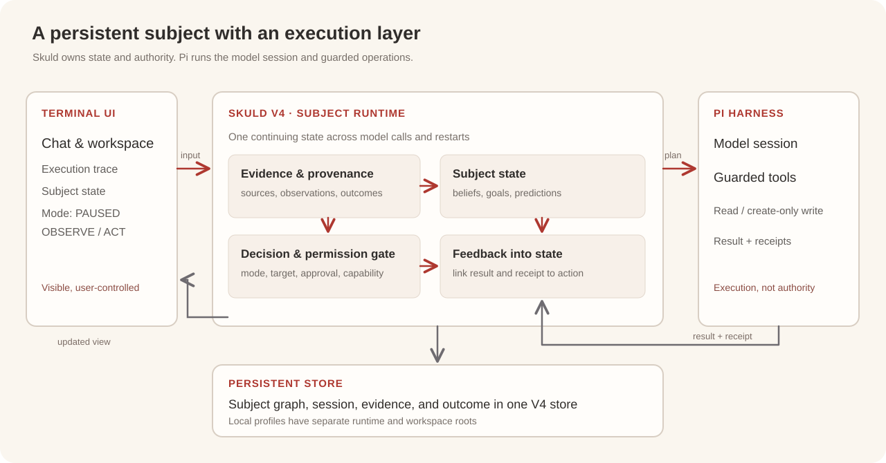

# Architecture · Skuld · Arrival

[Home](../README.md) · **English** · [简体中文](ARCHITECTURE.zh-CN.md)

Skuld is the persistent subject runtime. It holds the state that survives a model call, makes the decision to delegate, checks the local authority boundary, and incorporates the result. Pi is the execution layer for a model session or a guarded tool operation. The Terminal is the user's view into both.

Skuld · Arrival is the **Hackathon Release 2026** product built during the Meta Global AI Developer Hackathon, October 26–November 4, 2026. Its Terminal model route is the DeepSeek API. The locally served Meta model appears in a separate benchmark, with its own manifest and receipts.

## The implemented path

| Step | Owner | What crosses the boundary |
| --- | --- | --- |
| Input and mode | Terminal → Skuld | A user message or an explicit read/write request, with PAUSED, OBSERVE, or ACT mode |
| State and decision | Skuld V4 | Persisted subject state, source-linked evidence, and an action plan |
| Delegation | Skuld → Pi | A bounded model turn or a tool plan with target, operation, session, and capability |
| Execution | Pi | Model output or a guarded workspace operation, with result and receipt |
| Feedback | Pi → Skuld | Outcome status, receipt references, and errors where applicable |
| Display | Skuld → Terminal | Updated state and execution trace from recorded evidence |

The current Terminal exposes a model conversation, workspace read, and create-only write. OBSERVE permits conversation and read; ACT permits a write proposal that needs an exact local approval before execution. The Pi sidecar checks the operation and its resolved target against the capability issued for that action. [Terminal usage](TERMINAL.md) and the [wiring source](../terminal_app/v4_wiring.py) show this path.

## Public notation

These equations describe interfaces between stages. They are **conceptual**, not the numerical update rules, scoring functions, or learning parameters used by the V4 core.

$$
S_{t+1} = \mathcal{U}(S_t, E_t, O_t)
$$

Here $S_t$ is persisted subject state, $E_t$ is new source-linked evidence, and $O_t$ is the observed outcome of an action. A model response can inform an update; the durable state belongs to Skuld.

$$
\operatorname{execute}(a_t) \Longrightarrow
a_t \in \mathcal{A}(m_t, c_t, w_t)
$$

$m_t$ is the local mode, $c_t$ the action capability, and $w_t$ the allowed workspace. The expression says that a dispatched operation must be inside the permitted set. It does not imply that every permitted action should be taken.

$$
O_t = (\operatorname{status}_t,\ \operatorname{receiptRefs}_t,\ \operatorname{error}_t?)
$$

The outcome keeps success, failure, and receipt references distinct, so a failed operation can still contribute evidence. No numeric confidence or reward equation is disclosed by this notation.

## Persistence and recovery

The V4 graph uses the existing `PersonalAIStore` connection. Source events and subject nodes therefore share one persistent store rather than a second Terminal database. Terminal session and mode records live with the subject state; restarting the application recovers the same subject and the recorded tool outcomes. Named local profiles use separate runtime and workspace roots, while sharing application code.

The [Meta Glimmer 30B validation](../benchmarks/meta-glimmer-30b/README.md) provides a separate simulated-world example of persistent responsibility across a process restart. Its day-28 continuation used a higher call limit, as recorded in the manifest and report; it is not the unchanged original configuration.

## Read the implementation

| Boundary | Source |
| --- | --- |
| V4-owned session, mode, action approval, and feedback | [`terminal_app/v4_wiring.py`](../terminal_app/v4_wiring.py) |
| JSONL bridge and Pi receipts | [`terminal_app/pi_bridge.py`](../terminal_app/pi_bridge.py) |
| Pi operation checks | [`guarded_tools.ts`](../terminal_app/harness_pi/src/guarded_tools.ts) |
| Subject runtime | [`skuld/app/runtime.py`](../skuld/app/runtime.py) |
| Persistent graph store | [`skuld/kernel/graph_store.py`](../skuld/kernel/graph_store.py) |
| Local profile paths | [`terminal_app/accounts.py`](../terminal_app/accounts.py) |
