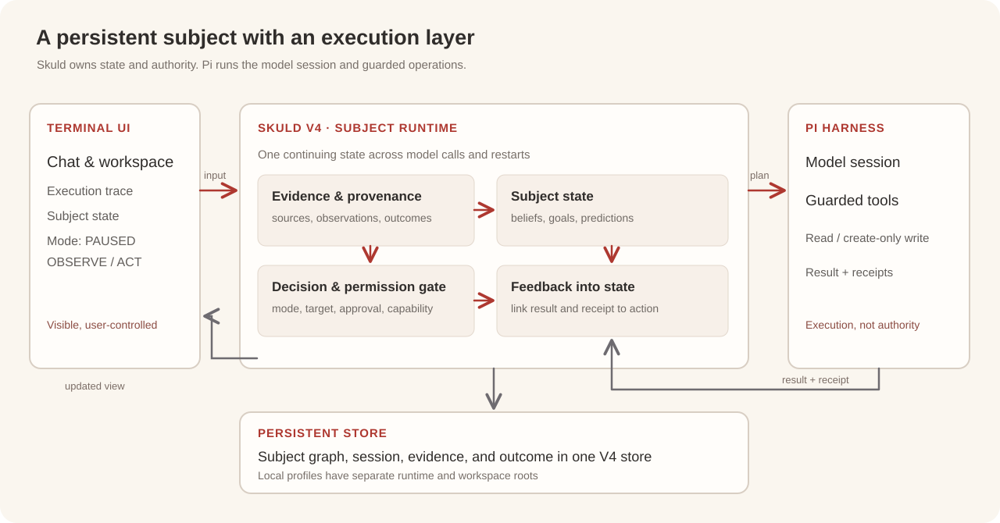

# 架构 · Skuld · Arrival

[首页](../README.zh-CN.md) · [English](ARCHITECTURE.md) · **简体中文**

Skuld 是持续存在的主体运行时：保存跨模型调用的状态，决定何时委托执行，检查本地权限边界，并吸收执行结果。Pi 承担模型会话与受约束的工具执行。Terminal 展示两者的真实状态和过程。

Skuld · Arrival 是在 2026 年 10 月 26 日—11 月 4 日 Meta Global AI Developer Hackathon 期间做出来的 **Hackathon Release 2026** 产品。Terminal 对话使用 DeepSeek API；本地部署的 Meta 模型属于独立 Benchmark，拥有自己的 manifest 与回执。

## 已接通的路径

| 阶段 | 负责方 | 传递的内容 |
| --- | --- | --- |
| 输入与模式 | Terminal → Skuld | 用户消息或明确的读写请求，以及 PAUSED、OBSERVE、ACT 模式 |
| 状态与决策 | Skuld V4 | 持久主体状态、有来源的证据和行动计划 |
| 委托 | Skuld → Pi | 有边界的模型调用，或带目标、操作、会话与 capability 的工具计划 |
| 执行 | Pi | 模型输出或受约束的工作区操作，以及结果与回执 |
| 回流 | Pi → Skuld | 结果状态、回执引用及错误信息 |
| 展示 | Skuld → Terminal | 已记录的主体状态与执行轨迹 |

当前 Terminal 支持模型对话、工作区读取和只创建新文件的写入。OBSERVE 可对话和读取；ACT 下的写入需先提出计划，再由用户精确批准。Pi 会核对操作与解析后的目标是否符合该行动的 capability。使用方法见 [Terminal 文档](TERMINAL.md)，接线见 [源码](../terminal_app/v4_wiring.py)。

## 公开层面的表示

以下公式只概括阶段之间的关系，并非 V4 核心的数值更新规则、评分函数或学习参数。

$$
S_{t+1} = \mathcal{U}(S_t, E_t, O_t)
$$

$S_t$ 表示已持久化的主体状态，$E_t$ 表示有来源的新证据，$O_t$ 表示行动的实际结果。模型输出可以参与判断，持续状态由 Skuld 保存。

$$
\operatorname{execute}(a_t) \Longrightarrow
a_t \in \mathcal{A}(m_t, c_t, w_t)
$$

$m_t$ 是本地模式，$c_t$ 是行动 capability，$w_t$ 是允许访问的工作区。只有落在许可集合中的操作才能被派发；被许可不等于应当执行。

$$
O_t = (\operatorname{status}_t,\ \operatorname{receiptRefs}_t,\ \operatorname{error}_t?)
$$

结果保留成功、失败和回执引用的区别，使失败也能成为下一步判断的证据。这些记号不代表具体置信度或奖励计算。

## 持久化与恢复

V4 图谱复用现有 `PersonalAIStore` 连接。来源事件和主体节点处于同一持久存储中；Terminal 不另建主体数据库。会话、模式与工具结果随主体状态保存，重启后可以恢复。命名本地账户各自拥有独立的运行目录和工作区，共享的只有程序代码。

[Meta Glimmer 30B 验证](../benchmarks/meta-glimmer-30b/README.md)提供了另一条模拟经营场景中的跨进程责任延续证据。第 28 天后的续跑提高了调用上限，其条件已在 manifest 和报告中标明。

## 源码入口

| 边界 | 源码 |
| --- | --- |
| 会话、模式、行动批准与结果回流 | [`terminal_app/v4_wiring.py`](../terminal_app/v4_wiring.py) |
| JSONL 桥接与 Pi 回执 | [`terminal_app/pi_bridge.py`](../terminal_app/pi_bridge.py) |
| Pi 工具检查 | [`guarded_tools.ts`](../terminal_app/harness_pi/src/guarded_tools.ts) |
| 主体运行时 | [`skuld/app/runtime.py`](../skuld/app/runtime.py) |
| 持久图谱 | [`skuld/kernel/graph_store.py`](../skuld/kernel/graph_store.py) |
| 本地账户路径 | [`terminal_app/accounts.py`](../terminal_app/accounts.py) |
